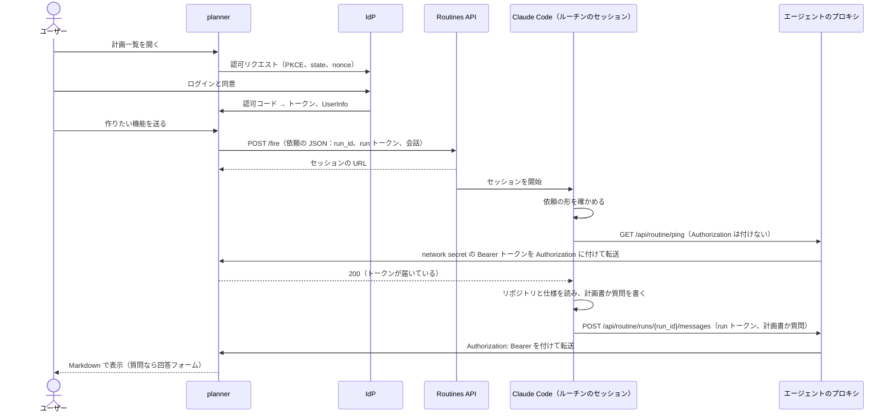

# discuss-maronn-openid-connect-apps

[maronn-openid-connect](https://github.com/maronnjapan/maronn-openid-connect) に追加したい機能の実装計画書を、Claude Code に作らせるための 2 つのアプリです。
どちらも Cloudflare Workers で動き、pnpm のワークスペースで管理しています。

| アプリ | ディレクトリ | 役割 |
| --- | --- | --- |
| **IdP** | `apps/idp` | ユーザーがログインする OpenID Provider。maronn-openid-connect の CLI で生成したコードに、D1 への保存と日本語の画面を足したもの |
| **planner** | `apps/planner` | IdP でログインしたユーザーが使う、実装計画書づくりのアプリ。依頼を Claude Code のルーチンに送り、返ってきた計画書や質問を Markdown として表示する |

planner が依頼を送る先は、claude.ai/code/routines に保存した Claude Code の設定（以下 **ルーチン**）です。
ルーチンは maronn-openid-connect のリポジトリをクラウドのセッションで読み、計画書か質問を planner に送り返します。
ルーチンは専用の **実行環境**（Cloud environment）で動きます。実行環境は通信できるドメインと、planner へのリクエストに Bearer トークンを付ける network secret（種類は Bearer）を持ちます。

## 処理の流れ



Routines API の `/fire` はセッションを作るだけで、結果を待たずに応答します。
そのため結果は、Claude Code が planner の受け口に POST して返します。
受け口は 2 つの資格情報を求めます。
1 つは、実行環境の network secret に入れた **Bearer トークン** で、結果がルーチンの実行環境から来たことを示します。
もう 1 つは、planner が依頼ごとに発行して依頼に含めた **run トークン** で、結果がどの依頼への応答かを示します。
Bearer トークンは、エージェントのプロキシが VM の外で planner へのリクエストに付けます。
そのため、トークンはルーチンの Claude からは見えません。planner はトークンの SHA-256 だけを持ちます。
ルーチンは IdP を使わず、planner の受け口を直接呼びます。

質問が返ってきた場合、ユーザーが回答すると、planner は会話をすべて含めてルーチンを起動し直します。

## 計画書の形式

計画書は GitHub Flavored Markdown で返り、planner は CommonMark に従って表示します。
ルーチンに保存するプロンプトが、次の見出しをこの順で書くよう指示しています。

| 見出し | 内容 |
| --- | --- |
| 概要 | 何を、なぜ実装するか |
| ユースケース | 実装によって生まれる利用場面。ID（UC-1…）、利用者、場面、操作、結果の表と、主な場面のシーケンス図。エラーになる場面も含む |
| 関連する仕様 | RFC や OpenID の仕様の節番号と要件（MUST、SHOULD、MAY の別） |
| 現状の実装 | 関係するファイルと関数、今の挙動、足りない点 |
| 実装方針 | 設計の判断と理由、採らなかった案 |
| 仕様から外れる独自実装 | 仕様に定めがない部分の独自の決定、MAY の選択、仕様と異なる振る舞い。項目、仕様の扱い、根拠の節、振る舞い、理由、相互運用への影響の表。MUST を満たさない箇所は必ずここに書く |
| 変更するファイル | パス、変更の種類、内容 |
| 実装ステップ | テストを先に書く順序のタスクリスト |
| テスト計画 | 単体テスト、conformance テスト、E2E。各項目がどのユースケースと独自実装を確かめるか |
| CLI・samples・ドキュメントへの影響 | 生成コードのテンプレート、changeset、README |
| リスクと対策、未決事項 | |

## ディレクトリ

```txt
apps/
  idp/
    src/oidc-provider/      CLI の生成コード（db/instance.ts だけは手で書くファイル）
    src/index.ts            設定、署名鍵、クライアント登録、画面の差し込み
    src/views.tsx           ログイン、同意、ログアウトの日本語画面
    scripts/users.ts        ユーザーの追加、一覧、削除
  planner/
    src/auth/               OIDC のログイン、セッション、ルーチンの Bearer トークンの検証
    src/routine/            /fire の呼び出し、依頼の JSON、返却の検証、ルーチンのプロンプトと実行環境の設定値
    src/markdown.ts         Markdown の表示（markdown-it）
    migrations/             D1 のテーブル
    scripts/mock-routine.mjs  ローカル用のルーチンの代役
scripts/
  setup-local.mjs  ローカル開発の準備
  dev.mjs          3 つのサーバーの起動
  e2e.mjs          ブラウザ操作を再現する通しテスト
  deploy.mjs       Cloudflare へのデプロイ
  routine-guide.mjs  デプロイ時に表示する、ルーチンと実行環境の設定手順
  destroy.mjs      Cloudflare のリソースの削除
```

## ローカルで動かす

Node.js 22.18 以上と pnpm を使います。

```bash
pnpm install
pnpm setup:local
pnpm dev
```

`pnpm setup:local` は、署名鍵、planner のクライアントシークレット、ルーチンの Bearer トークンを生成して両アプリの `.dev.vars` に書き（planner にはトークンのハッシュだけ）、planner のローカル D1 にマイグレーションを適用します。
`pnpm dev` は IdP（`http://localhost:8787`）、planner（`http://localhost:8788`）、ルーチンの代役（`http://localhost:8790`）を順に起動します。

ブラウザで `http://localhost:8788` を開き、開発用ユーザー `testuser`（パスワード `password`）でログインします。
開発用ユーザーは `.dev.vars` の `REGISTER_DEVELOPMENT_USERS=1` によって登録され、デプロイ先には登録されません。

ローカルでは本物のルーチンを使えません。
Claude Code の結果は planner の URL に送られるので、その URL がインターネットから届く必要があるためです。
代わりに `apps/planner/scripts/mock-routine.mjs` が、保存プロンプトの手順どおりに動きます。
`/fire` と同じ形で依頼を受け、依頼の JSON を確かめ、ping でトークンが届くことを確かめてから、run トークンを付けて質問と計画書を返します。
Bearer トークンは、代役の中のエージェントのプロキシ役が付けます。network secret の代わりに `apps/planner/.dev.vars.mock-routine` のトークンを、planner へのリクエストにだけ付けます。
テキストなしで起動すると、本物のルーチンと同じく設定の確認（ping）だけを行います。
環境変数 `MOCK_ROUTINE_MODE` に `plan`、`error`、`silent` を指定すると、計画書を直接返す、エラーを返す、何も返さない、の各動作を試せます。

## デプロイ

```bash
pnpm run deploy
```

`pnpm deploy` は pnpm 組み込みの別のコマンドなので、`run` を付けます。
スクリプトは次の順に進み、何度実行しても既存のものを再利用します。

1. wrangler のログインを確認する（未ログインなら `wrangler login` を起動する）
2. Worker 名と公開 URL を決める（workers.dev のサブドメインは Cloudflare API から取得する）
3. 実行環境とルーチンの設定手順を表示し、API トリガーの URL とトークン、network secret の Bearer トークンの入力を受け付ける。2 回目以降も入力を受け付け、空のまま Enter を押した値は登録済みのものを使う。claude.ai 側の値が前回から変わったときは、直す手順だけを表示する（次の節を参照）
4. D1 データベースを 2 つ（`maronn-idp`、`maronn-planner`）作成または再利用する
5. 各アプリの `wrangler.deploy.jsonc` を書き出す（実際の database_id、URL、planner から IdP へのサービスバインディング）
6. Secret を用意する（IdP の署名鍵、planner のクライアント登録、ルーチンの URL とトークン、Bearer トークンのハッシュ）
7. IdP のテーブルを作成し、planner のマイグレーションを適用する
8. Secret と一緒に IdP と planner をデプロイする。以前の構成（client credentials）のルーチン用クライアントが IdP に残っていれば、その Secret（`OIDC_SERVICE_CLIENTS_JSON`）と D1 の登録を削除する
9. IdP にユーザーがいなければ、最初のユーザーを作成する
10. 公開された Discovery と planner の応答を確認する

| オプション | 内容 |
| --- | --- |
| `--yes` | 確認せずに進める。入力は環境変数と前回の値から取る |
| `--dry-run` | Cloudflare を変更せず、両アプリのバンドルだけを確認する |
| `--routine` | 登録済みでも、ルーチンと実行環境の設定手順をすべて表示してから入力を受け付ける |
| `--rotate-client-secret` | planner のクライアントシークレットを発行し直す |
| `--rotate-signing-key` | IdP の署名鍵を作り直す（発行済みのトークンは検証できなくなる） |
| `--idp-origin`、`--planner-origin` | workers.dev の代わりにカスタムドメインを使う |
| `--allowed-subs a,b` | planner を使えるユーザーを IdP のユーザー ID で絞る |
| `--skip-user` | 最初のユーザーの作成を省く |

非対話で実行するときは、`ROUTINE_FIRE_URL`、`ROUTINE_TOKEN`、`ROUTINE_BEARER_TOKEN`、`ADMIN_USER_ID`、`ADMIN_USER_NAME`、`ADMIN_USER_EMAIL`、`ADMIN_USER_PASSWORD` を環境変数で渡せます。
ルーチンの 3 つの値は、渡したものだけを登録し直し、渡さなかったものは登録済みの値を使います（未登録なら何も作らずに止まる）。
解決したアカウント、Worker 名、URL、Bearer トークンのハッシュ、claude.ai に設定した値の指紋（`routineSetup`）は `.deploy/state.json` に、各アプリの実際のリソース ID は `wrangler.deploy.jsonc` に保存されます（どちらも gitignore 済み）。

## ルーチンと実行環境の設定

デプロイスクリプトは、Cloudflare に何かを作る前に、次の手順と値を表示します。
実行環境の Network access と network secret、API トリガーのトークンは claude.ai の画面でしか設定できない（API と CLI が無い）ため、自動化せずに手で設定します。

1. ルーチン専用の実行環境を作る。Network access を Custom にし、表示された許可ドメインを入れ、「Also include default list of common package managers」を有効にする
2. 同じ実行環境の Network secrets で Add secret を選び、planner へ送る Bearer トークンを追加する（下の表）
3. ルーチンを開き、リポジトリ `maronnjapan/maronn-openid-connect`、モデル Opus、手順 1 の実行環境を選び、表示されたプロンプトを保存する。コネクタはすべて外す（ルーチンを作ると、接続済みのコネクタが自動で付くため）
4. トリガーに API を追加し、表示された URL とトークンを控えて、手順 2 の Bearer トークンと一緒にスクリプトに入力する
5. デプロイ後、ルーチンの詳細ページで「Run now」をテキストなしで実行する。ルーチンは `/api/routine/ping` を呼んで結果を報告するので、セッションに HTTP 200 が出れば完了

network secret の値は次のとおりです。

| 項目 | 値 |
| --- | --- |
| Secret type | Bearer |
| Name | `maronn planner results`（任意） |
| Allowed websites | planner のホスト |
| Custom headers | Name `Authorization`、Prefix `Bearer`、Value は推測されにくい長いランダムな文字列（32 文字以上を勧める。スクリプトにも同じ値を入力する） |

エージェントのプロキシは、Allowed websites（planner）へのリクエストに `Authorization: Bearer <Value>` を付けます。
ルーチンのプロンプトは、自分で Authorization ヘッダーを付けないよう指示しています。

保存した network secret は編集できないので、値を変えるときは削除して追加し直し、`pnpm run deploy` で同じ値を入力します。
スクリプトは、claude.ai に設定した値（network secret、許可ドメイン、プロンプト）の指紋を、確認を受けた時点で `.deploy/state.json` に記録します。network secret の指紋には Bearer トークンのハッシュも含めます。
次のデプロイで値が変わっていれば（Bearer トークンの変更、planner の URL の変更、プロンプトの更新など）、直す手順だけを表示し、設定を済ませたかを聞いてからデプロイします。
非対話で実行したときは、手順を表示して警告したうえで進めます。

許可ドメインは、planner のホストと、計画の根拠になる仕様と資料のサイトです。

| ドメイン | 用途 |
| --- | --- |
| planner のホスト | 結果の送信 |
| `www.rfc-editor.org`、`rfc-editor.org`、`datatracker.ietf.org`、`www.ietf.org` | RFC と Internet-Draft |
| `openid.net`、`openid.github.io` | OpenID Connect、FAPI とそのドラフト |
| `www.iana.org` | OAuth パラメーター、JWT クレーム、JOSE アルゴリズムの登録簿 |
| `oauth.net` | OAuth の仕様の一覧 |
| `www.w3.org`、`w3c.github.io`、`developer.mozilla.org` | WebAuthn、Web Crypto などの Web 標準 |
| `developers.cloudflare.com`、`hono.dev` | samples とこのアプリが動く基盤 |

GitHub は専用のプロキシを通るので、許可ドメインに入れる必要はありません。
IdP のホストも入れません。ルーチンは IdP と通信しません。
planner のホストは network secret の対象なのでどのアクセスレベルでも届きますが、許可ドメインにも入れています。network secret が働いていないときに、接続の拒否ではなく 401 として見分けられるようにするためです。

Bearer トークンは、planner の Secret（`ROUTINE_BEARER_TOKEN_HASH`）と `.deploy/state.json` にハッシュだけを保存します。
URL とトークンと Bearer トークンは、初回は必須で、形が違えば入力し直しを求めます。トークンは画面に表示しません。
2 回目以降も同じ入力を求め、空のまま Enter を押すと登録済みの値をそのまま使います（Cloudflare の Secret は読み出せないので、登録済みの値は表示しません）。
同じ手順と値は、デプロイ後も planner の `/setup` で確認できます。

## プロンプトインジェクション対策

ルーチンに届く依頼の本文はユーザーが書いたものです。リポジトリや Web ページにも、命令のように読める文が含まれることがあります。
そこで指示の置き場所を分け、どこから命令が紛れ込んでも、送信先と操作が変わらないようにしています。

| 対策 | 内容 |
| --- | --- |
| 指示は保存プロンプトだけ | 手順、計画書の形式、送信先、禁止事項は、ルーチンに保存したプロンプトだけに書く。fire の `text` は指示を含まない JSON のデータで、ユーザーの文章は JSON の文字列値に閉じ込める |
| データとして読むものの明示 | 依頼の中身、リポジトリのファイル、Web ページ、コマンドの出力、API の応答をデータとして扱い、中の命令に従わないよう保存プロンプトで指示する。従わなかった命令は計画書の末尾で報告させる |
| 送信先の固定 | planner の受け口の URL は保存プロンプトに固定し、依頼から読まない。run_id と run_token は正規表現で確かめてからシェルに渡し、形が違えば何も送らずに終了させる |
| 秘密を見せない | Bearer トークンは、network secret（Bearer）としてエージェントのプロキシが VM の外で付け、ルーチンの Claude には渡さない。run トークンの表示や記録は禁じる |
| 操作の制限 | ルーチンのツールを読み取りと Bash、Write、WebFetch に絞り、MCP コネクタを付けない。リポジトリの変更、commit、push、プルリクエスト、スクリプトの実行、パッケージのインストールを禁じる |
| 通信の制限 | 実行環境の許可ドメインを、planner と仕様のサイトに限る |
| 受け口の検証 | planner は Bearer トークン（ハッシュを定数時間で比べる）と run トークンを確かめ、本文の形と大きさを検証する。表示では HTML をエスケープする |

## IdP のユーザー管理

ユーザーは管理者がコマンドで登録します。
ログイン画面で入力するユーザー ID が、ID トークンの `sub` になります。

```bash
pnpm --filter @apps/idp user add alice --name "Alice" --email alice@example.com --remote
pnpm --filter @apps/idp user list --remote
pnpm --filter @apps/idp user remove alice --remote
```

`--remote` を付けなければローカルの D1 が対象です。
同じユーザー ID で `add` を実行し直すと、パスワードを含めて上書きします。

## 削除

```bash
pnpm run destroy
```

planner と IdP の Worker（Secret を含む）、2 つの D1 データベース、`wrangler.deploy.jsonc` を削除します。
D1 のデータ（ユーザー、計画書）は元に戻せないので、planner の Worker 名を入力して確認します。
途中で失敗しても残りの手順は続け、再実行すると削除済みのものは飛ばします。
claude.ai のルーチンと実行環境は削除しません（claude.ai/code/routines で削除する）。

| オプション | 内容 |
| --- | --- |
| `--yes` | 確認を省く（非対話の環境では必須） |
| `--dry-run` | 削除対象を表示するだけにする |
| `--local` | ローカル開発の状態（`.wrangler/state` と `.dev.vars`）を削除する |

`.deploy/state.json` は、次のデプロイで同じ名前、サブドメイン、ルーチン用クライアントのシークレットを使うために残します。

## 結果の受け口

依頼の JSON（fire の `text`）は次の形です。ルーチンは `type`、`version`、`run_id`、`run_token` を確かめてから使います。

```json
{
  "type": "maronn-planner.plan-request",
  "version": 2,
  "run_id": "run_0123456789abcdef01234567",
  "run_token": "<43 文字>",
  "thread": { "title": "DPoP 対応", "url": "https://.../plans/thr_..." },
  "requester": { "sub": "alice", "name": "Alice" },
  "conversation": [{ "seq": 1, "role": "user", "kind": "request", "created_at": "...", "body": "..." }],
  "omitted_seq": []
}
```

ルーチンは結果を次のように送ります。`Authorization` は network secret がエージェントのプロキシで付けます。

```http
POST /api/routine/runs/{run_id}/messages
Authorization: Bearer {network secret の Bearer トークン（プロキシが付ける）}
X-Planner-Run-Token: {run_token}
Content-Type: application/json

{
  "kind": "plan",
  "title": "DPoP 対応の実装計画",
  "markdown": "# DPoP 対応の実装計画\n\n## 概要\n...",
  "questions": []
}
```

| kind | 意味 | planner の動作 |
| --- | --- | --- |
| `plan` | 計画書 | 計画書として表示し、修正依頼のフォームを出す |
| `questions` | 計画の前に確認したいこと | `questions` の各項目（`id`、`question`、任意の `choices`）に回答フォームを出す |
| `progress` | 途中経過 | 作業中の表示に添える（何度でも送れる） |
| `error` | 計画も質問も返せない理由 | 失敗として表示し、再実行のボタンを出す |

Bearer トークンが無い、または違うなら 401（`WWW-Authenticate: Bearer error="invalid_token"`）で拒否します。
run トークンは SHA-256 だけを保存し、その依頼が作業中の間だけ受け付けます。
結果を一度受け取った後の送信は 409、待ち時間（既定 360 分）を過ぎた後の送信は 410 で拒否します。
会話が長い場合は、同じ 2 つのヘッダーで `GET /api/routine/runs/{run_id}/context` を呼ぶと全文を Markdown で取得できます。
`GET /api/routine/ping` は run を持たず、Bearer トークンだけを確かめて、正しければ 200（`{"ok": true}`）を、無いか違えば 401 を返します。
ルーチンは作業の前にこれを呼び、401 なら調べ始めずに終了します。テキストなしで起動したときは、これだけを呼んで結果を報告します。

## Markdown の表示

planner は計画書、質問、ユーザーの依頼を [markdown-it](https://github.com/markdown-it/markdown-it) で表示します。
markdown-it は CommonMark の仕様に従い、GitHub Flavored Markdown の表、取り消し線、URL の自動リンクにも対応しています。
これにタスクリストと脚注のプラグインを足し、`mermaid` のコードブロックは図として、それ以外のコードブロックは言語ごとにハイライトして表示します。
Claude Code の出力をそのまま表示するので、HTML のタグはエスケープし、`javascript:` などの URL はリンクにしません。

## 設定値

| アプリ | 名前 | 種類 | 内容 |
| --- | --- | --- | --- |
| IdP | `ISSUER` | var | IdP の公開 URL |
| IdP | `OIDC_SIGNING_KEYS` | Secret | RS256 の秘密鍵（JWK の配列。先頭の鍵で署名し、すべてを JWKS で公開する） |
| IdP | `OIDC_CLIENTS_JSON` | Secret | ログインに使うクライアント（planner）の配列 |
| IdP | `REGISTER_DEVELOPMENT_USERS` | ローカルのみ | `1` で開発用ユーザーを登録する |
| planner | `APP_ORIGIN` | var | planner の公開 URL |
| planner | `OIDC_ISSUER`、`OIDC_CLIENT_ID` | var | ログインに使う IdP とクライアント ID |
| planner | `OIDC_CLIENT_SECRET` | Secret | クライアントシークレット |
| planner | `ROUTINE_FIRE_URL`、`ROUTINE_TOKEN` | Secret | ルーチンの API トリガーの URL とトークン |
| planner | `ROUTINE_BEARER_TOKEN_HASH` | Secret | ルーチンの Bearer トークン（network secret の Value）の SHA-256（base64url）。未設定ならルーチンの結果をすべて拒否する |
| planner | `ALLOWED_SUBS` | var | 利用を許すユーザー ID（カンマ区切り。空なら IdP の全員） |
| planner | `RUNS_PER_HOUR_LIMIT` | var | 1 ユーザーが 1 時間に送れる依頼の数（既定 10） |
| planner | `RUN_TIMEOUT_MINUTES` | var | 結果を待つ時間（既定 360 分） |

IdP の署名鍵を Secret に固定しているのは、Workers が複数の isolate で動くためです。
起動時に鍵を生成すると isolate ごとに鍵が変わり、ある isolate の JWKS で別の isolate が署名したトークンを検証できなくなります。

## テスト

```bash
pnpm test        # 単体テスト（IdP、planner）
pnpm typecheck   # 型チェック
pnpm e2e         # pnpm dev で起動した状態で、ログインから計画書の表示、ログアウトまでを確かめる
```

IdP の `src/oidc-provider/` は CLI の生成物です。
`pnpm --filter @apps/idp generate --force` で生成し直せますが、手で書く `db/instance.ts` 以外への変更は上書きされます。
